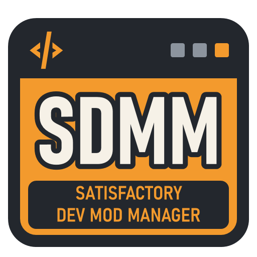

# Satisfactory Dev Mod Manager (SDMM)



A small mod manager for Satisfactory **dev builds**. It installs mod builds from GitHub releases next to what SMM (Satisfactory Mod Manager) manages, without breaking SMM-managed mods. It works on your own game and on dedicated servers, both hosted ones (such as Indifferent Broccoli, over SFTP or FTP) and ones running on your own PC. It is meant for a few people who make mods together and want to test each other's builds before uploading them to the mod repository.

SML needs no changes: it loads any valid plugin folder under `FactoryGame/Mods`.

SDMM is an unofficial community tool. It is not affiliated with or endorsed by Coffee Stain Studios or the Satisfactory Modding team, makers of Satisfactory Mod Manager (SMM) and Satisfactory Mod Loader (SML).

Multiplayer Status: tested and working with Indifferent Broccoli hosted servers over SFTP. Other hosts and FTP/FTPS connections should work the same way but haven't been tried yet. Dedicated servers on your own PC are supported (SDMM changes their folder directly, as it does for your game) but haven't been tried with a running server yet.

## Testing a dev build of a mod you normally get through SMM

1. In SMM, remove the mod from your profile and apply it. Otherwise SMM replaces the dev build the next time it applies, and SDMM refuses to install until you do this.
2. In SDMM, pick your game installation in the sidebar, click **Check for new mod builds**, select the mod, choose the build in the details panel, and click **Install**. The game must be closed.
3. When you're done testing, click **Remove** in SDMM, then add the mod back in SMM. If you forget to remove it first, SMM simply replaces it, which is harmless.

## Playing and launch options

**Play Satisfactory** (bottom of the sidebar) starts the selected game's own exe, so a second copy of the game launches itself rather than your Steam install. To pass switches such as `-DX12` or `-log`, set that game's **Launch options** under **Settings → Games & servers**. Steam's own launch options don't apply here, because SDMM starts the exe directly.

## Dedicated servers (hosted or on your PC)

SDMM manages dedicated servers rented from a host and dedicated servers running on your own PC the same way. Switch the top of the sidebar from **My game** to **Server** to manage a server's mods directly: the list then shows the server's mods, and Install, Update and Remove act on the server. Restart the server afterwards so it loads the change; a hosted server usually has to be stopped first (see below).

Click **Add server…** (in Server mode, or under **Settings → Games & servers**) and pick the kind:

- **Hosted server** (Indifferent Broccoli, G-Portal and other hosts): enter the SFTP (or FTP/FTPS) login from your host's panel, then click **Test connection** before saving.
  - The test connects and checks the game folder. If `FactoryGame` is a level or two below the folder you typed, it offers to use that folder instead, so you can leave **Game folder** as `/` if you're unsure.
  - If the host hides the `Engine` folder, set **Platform** (usually LinuxServer).
  - The server's key or certificate is saved on first connect, and a different one later is refused.
- **Dedicated server on this PC** (for example Steam's free "Satisfactory Dedicated Server"): SDMM finds Steam's automatically, or you pick the folder. A game folder is refused here; the game goes under My game.

### How server logins are stored

A hosted server's login is saved in SDMM's settings file (`%LOCALAPPDATA%\SatisfactoryDevModManager\sdmm.config.json`):

- **Password:** encrypted with Windows DPAPI for your Windows account, the same way as the GitHub token. It can't be read from another Windows account or another PC, though programs running under your own account could decrypt it, as with any app's saved passwords. It is only sent to the server you entered.
- **Host, port, user name and game folder:** saved as plain text.
- **Private key:** only the key file's location is saved, not the key. SDMM reads the file each time it connects. Keys protected by a passphrase aren't supported.
- **Server identity:** the server's SSH host key (or its FTPS certificate) is remembered on first connect, and a different one later is refused, because that can mean someone is intercepting the connection.
- **Encryption in transit:** SFTP and FTPS encrypt the connection, including the password. Plain FTP (FTPS turned off) sends the password unencrypted; only use it if your host offers nothing else.

**Stop a hosted server before changing its mods.** Hosted servers (Indifferent Broccoli, for one) lock their files while the game server is running, so SDMM can't change them. SDMM checks when it reads the server and before every change. If the server refuses, SDMM tells you it's probably running: stop it in your host's panel, wait until it shows as stopped, and click **Try again**. Start the server again when you're done.

Hosting a game from your own Satisfactory client (not a dedicated server) is just your game: manage it under My game.

**Sync with server…** (sidebar, under Multiplayer) compares your game with the server. It can make your game match the server, or make the server match your game, so SML lets you join. It installs the right build for the side being changed (Windows for your game, LinuxServer or WindowsServer for the server). It follows SML's own rules for joining:

- Versions must match, unless a mod's `.uplugin` sets a `RemoteVersionRange` that allows others.
- A mod that one side has and the other lacks blocks joining, unless its `.uplugin` sets `"RequiredOnRemote": false`. Mods like that (the server-only DepotNetworkFix, or client-only mods) are never copied to or removed from the other side.
- Dev builds on the side being changed that the other side doesn't have are offered for removal. SMM-managed mods are reported rather than changed.

Tick or untick each line before you click **Match**.

## Modpacks

A modpack is a named list of mods and versions; SMM calls these profiles. Open **Modpacks…** in the sidebar to:

- **Save** the selected game or server as a modpack.
- **Export** a modpack to a `.modpack.json` file, or **import** one someone sent you.
- **Edit** a modpack: switch mods on or off, remove them, or set where each goes (both, players only, or server only).
- **Apply** it to the selected game or server.

Applying installs or updates what's needed and, if you tick the option, removes SDMM-managed mods that aren't in the pack. Everything is listed in one confirmation first.

Modpacks don't contain files, so one pack works everywhere. The right build is picked for whatever it's applied to: Windows for a game, LinuxServer or WindowsServer for a server. Mods marked for players only are skipped on a server, and mods marked for the server only are skipped on a game. When you save a pack, mods whose `.uplugin` sets `RequiredOnRemote` to false are marked for the side they were found on.

Mods in a pack that come from SMR are listed but not installed; install those with SMM. GitHub dev builds and imported zips are installed by SDMM.

## GitHub token (recommended)

Without a token, GitHub allows 60 requests per hour. Each **Check for new mod builds** costs about 2 + (number of scanned repos) requests, so a few checks can use that up. A read-only token raises the limit to 5,000 per hour. Tokens are free with any GitHub account.

1. Sign in to GitHub and open **Settings → Developer settings → Personal access tokens → Fine-grained tokens**, then click **Generate new token**. The direct link is <https://github.com/settings/personal-access-tokens/new>.
2. Name it (for example "SDMM") and pick an expiration. When it expires, make a new one.
3. Under **Repository access**, choose **Public repositories**. That is enough to read public mod releases. To also read your own private repos, choose **Only select repositories**, pick them, and set **Permissions → Contents** to **Read-only**. Don't grant anything else.
4. Click **Generate token** and copy it. GitHub shows it only once.
5. In SDMM, open **Settings… → GitHub token** in the sidebar (or choose **Add a token now** on the startup prompt), paste the token and click **Save**.

The token is stored encrypted with Windows DPAPI for your Windows account, in SDMM's settings file (`%LOCALAPPDATA%\SatisfactoryDevModManager\sdmm.config.json`), and it is only sent to `api.github.com`. Don't paste it anywhere else. You can revoke it on the same GitHub page at any time.

A fine-grained token can only read private repos owned by its resource owner (you, or an organization you choose). To read a friend's private repos, either use an organization you both belong to as the resource owner, or have them make the mod repos public.

A topic filter under **Settings → Mod sources** also cuts the request count, because unrelated repos aren't scanned.

If GitHub is having problems (502/503/504 or timeouts), each request is retried twice. After that, the app shows the data from the last successful check and says so in the log.

## Installing a zip by hand

**Install from zip…** (sidebar, under Builds) adds mod zips that aren't on GitHub, such as a build sent to you directly or your own Alpakit output from `Saved/ArchivedPlugins/<Mod>/`.

- Each zip is checked: it needs a `.uplugin` at its root and a valid `SemVersion`.
- The zip is copied into SDMM, so the original can be moved or deleted.
- It's listed with the mod's other builds, marked "imported zip".
- If it fits the selected game or server, SDMM offers to install it right away.

The platform comes from the file name (`<Mod>-Windows.zip`, `-WindowsServer.zip` or `-LinuxServer.zip`). If the file was renamed, SDMM reads it from the zip's contents instead. Imported zips are never removed when the download cache is cleaned up; delete them under **Settings → Storage**.

## Reading the mod list

Each installed mod has a tag showing who manages it:
- **SDMM dev**: installed by SDMM, so SDMM can update or remove it.
- **SMM**: installed by SMM. Change it in SMM.
- **Manual** (on a server, **Host / manual**): copied in by hand or by another tool, such as a host's own mod installer. SDMM leaves these alone.

Hover over a disabled Install or Remove button to see why it's disabled.

SDMM also flags problems with installed mods, with an explanation in the details panel:
- a mod installed twice
- a broken copy
- a mod that needs a different game version
- a missing or mismatched dependency
- a dev build that SMM will replace because your SMM profile still lists the mod

Pick **Has problems** in the filter to list just those mods.

When a dependency is missing or the wrong version, a banner above the list offers **Install missing dependencies** (the mod's details panel has the same button). SDMM installs it from your sources, choosing a version that suits every installed mod that needs it. If one isn't in your sources, it tells you to install that one with SMM, or to add the repo that publishes it.

## How it coexists with SMM

- Each mod folder the tool installs gets a `.sdmm.json` marker, never SMM's `.smm` marker, because ficsit-cli deletes `.smm` folders that are not in the profile it applies.
- It never changes folders that have `.smm` or no marker at all without asking you first.
- It refuses to install a mod that an SMM profile for that install contains (directly or through the lockfile), because SMM would overwrite it on its next apply. **Remove the mod from your SMM profile first.**
- It never edits SMM's `profiles.json` without asking you first, and never edits `installations.json`.

## Publishing your mod builds (for mod authors)

- Tag each release `v<SemVersion>`, exactly matching `SemVersion` in the `.uplugin`. The tool blocks a mismatch.
- **Bump the SemVersion on every build you share.** SML requires the client and server versions to be equal in both directions. Two different builds with the same version pass that check and then desync.
- For dev builds, use a `-dev.N` prerelease (for example `1.2.0-dev.3`) and mark the GitHub release as a prerelease. Avoid prerelease forms with an equal numeric field before a differing one (for example `rc.1.5` vs `rc.1.6`), because SML orders those wrongly.
- Upload Alpakit's per-target zips from `Saved/ArchivedPlugins/<Mod>/` unchanged: `<Mod>-Windows.zip`, `<Mod>-WindowsServer.zip`, `<Mod>-LinuxServer.zip`.

## SMR listings

When a dev mod is also published on SMR (ficsit.app), SDMM shows its logo, name and short description in the list. The details panel then has a **Published (SMR)** tab next to **Dev build (GitHub)**. SDMM sends only the mod names to SMR's public API, once per check. Turn this off under Settings → SMR.

## Updating SDMM

SDMM checks its own GitHub releases at startup; turn that off with **Check for updates at startup** under **Settings → Updates**, or check manually with **Check for SDMM updates** on the same tab. When an update is found, you can update now, be asked later, or skip that version. A skipped version isn't offered again at startup, but newer ones are. Updating downloads the new exe, verifies it against GitHub's SHA-256 checksum and restarts. A copy in a folder SDMM can't write to opens the release page instead.

## Checking mod files with VirusTotal (optional)

Under **Settings → Security**, SDMM can check each mod file with [VirusTotal](https://www.virustotal.com/) the first time it's installed, using your own free VirusTotal API key. It's off by default; the tab has short steps for getting a key. The key is stored encrypted for your Windows account, like the GitHub token, and only sent to virustotal.com.

- A check sends only the file's SHA-256 fingerprint. If antivirus engines flag the file, SDMM shows how many and a link to the report, and asks before installing. Everything else goes in the activity log.
- New dev builds usually aren't known to VirusTotal yet. To have those scanned too, turn on **Upload files VirusTotal hasn't seen yet**. That sends the whole file to VirusTotal, where its paying customers can download it, so leave it off for builds that aren't public. A first scan takes a minute or two.
- Each file is checked once. If VirusTotal can't be reached or the free key's limit (4 checks a minute, 500 a day) is used up, installing carries on and the log says what wasn't checked.

## Command line (optional)

`SatisfactoryDevModManager-cli.exe`, on the same release page, does the everyday dev-mod jobs from a command prompt or a script, for example updating a server's dev builds on a schedule. It uses the same settings, download cache and logs as the app, so set up your games, servers, sources and token in the app first. It manages dev builds from your sources and imported zips only.

```
SatisfactoryDevModManager-cli installs                      list your games and servers
SatisfactoryDevModManager-cli mods --on "IB Server"         dev mods there: installed, newest, status
SatisfactoryDevModManager-cli install AutoTrains            install or update a mod (newest build)
SatisfactoryDevModManager-cli install AutoTrains v1.4.14    a specific build
SatisfactoryDevModManager-cli remove AutoTrains
SatisfactoryDevModManager-cli update --on "IB Server" --yes update every dev build that has a newer one
SatisfactoryDevModManager-cli match --game "Steam (C:)" --server "IB Server" --change server
SatisfactoryDevModManager-cli modpack "Coop" --on "IB Server"
```

- `--on` picks a game or server by its name in the app (or its number from `installs`). Without it, the game you last picked in the app is used.
- Changes are listed and confirmed before they're made. `--yes` answers yes for you; without a console to ask on (in a script), the answer is no unless `--yes` is given.
- `--yes` doesn't trust a server key seen for the first time (add `--accept-new-host-key` after comparing it with your host's) or install a file VirusTotal flags (add `--allow-flagged`). VirusTotal checks run if you've turned them on in the app.
- The same safety checks apply as in the app: the game must be closed, mods SMM or someone else installed are left alone, and a hosted server that's running is detected.
- Exit codes: 0 done, 1 error, 2 bad arguments, 3 stopped (declined or refused), 4 the server's files are locked (stop the server, then try again).
- `--help` lists everything. The command line tool doesn't update itself; download the new one from the release page when you update the app.

## Where SDMM keeps its files

SDMM is a single portable exe with no installer, and it doesn't need .NET installed. Its settings (`sdmm.config.json`), the download cache and imported zips live in `%LOCALAPPDATA%\SatisfactoryDevModManager`, so moving or re-downloading the exe keeps them. The cache keeps the newest 2 builds of each mod file and can be cleared under **Settings → Storage**. To put the cache on another drive, set `cacheDirectory` in the settings file. To use a different settings file, start SDMM with `--config <path>`.

Logs go in the same folder:

- `crash.log` is always written when SDMM hits an unexpected error. It stays under 1 MB.
- `sdmm.log` is a detailed log of everything SDMM does: files it changes in your games and on servers, its own settings and cache files, changes to SMM's profiles, web requests, programs it starts, and errors in full. It's off by default; turn it on under **Settings → Storage**. It stays under 5 MB by dropping the oldest lines first.

Logs include folder paths and server addresses, but never tokens, keys or passwords. **Settings → Storage → Open log folder** opens the folder.

## Reporting problems

Report bugs and other problems on this repository's [Issues](../../issues) page. A useful report says:

- which SDMM version you're on (**Settings → Updates**),
- whether it happened on your game or a server, and for a server, which host and whether it's SFTP or FTP,
- what you did, what you expected, and what happened instead,
- the relevant lines from the activity log (open it from the status bar under the mod list) or the command line tool's output, or `crash.log` if SDMM showed an unexpected error. For a problem you can repeat, turn on the detailed log under **Settings → Storage**, repeat it, and attach `sdmm.log` (see [Where SDMM keeps its files](#where-sdmm-keeps-its-files)).

Before posting, remove anything personal from what you paste, such as your Windows user name in folder paths, server addresses and user names. Never post a token or password.

## License

Copyright (C) 2026 Zambie223

SDMM is free software: you can redistribute it and/or modify it under the terms of the GNU General Public License as published by the Free Software Foundation, either version 3 of the License, or (at your option) any later version. It is distributed in the hope that it will be useful, but WITHOUT ANY WARRANTY; without even the implied warranty of MERCHANTABILITY or FITNESS FOR A PARTICULAR PURPOSE. See [LICENSE](LICENSE) for the full text.

The exe bundles third-party components under the MIT License; see [THIRD-PARTY-NOTICES.md](THIRD-PARTY-NOTICES.md).

## Responsible AI use disclosure

Most of the code, tests and documentation in this repository were written by an AI coding assistant (Claude, made by Anthropic, used through Claude Code), working under the maintainer's direction. The maintainer set the requirements and design decisions. Correctness was checked with the automated test suite in `tests/` and with hands-on runs against real game installs, real GitHub releases and an Indifferent Broccoli hosted server, but not every line has been reviewed by a person. AI-written code can contain mistakes: review it before relying on it, especially the parts that write to game folders or servers, and report any problems you find on the [Issues](../../issues) page (see [Reporting problems](#reporting-problems)).
